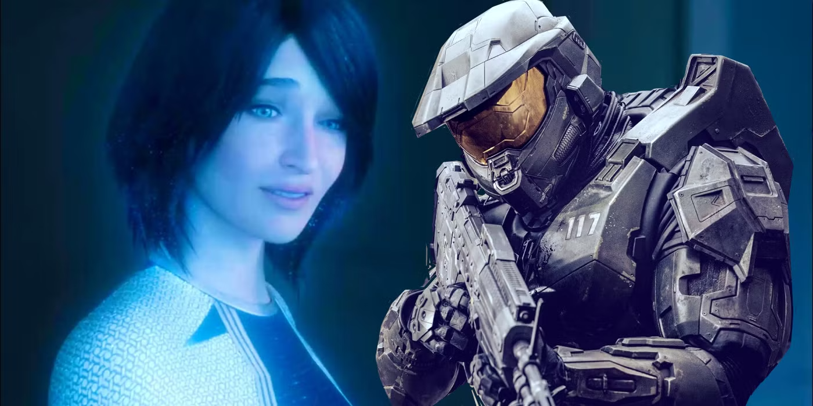
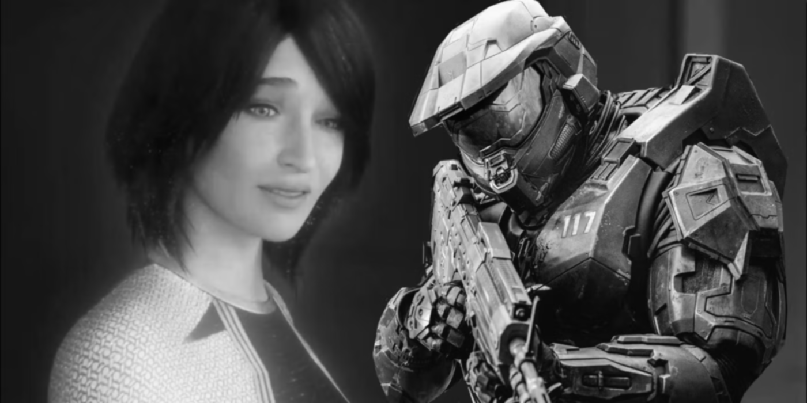
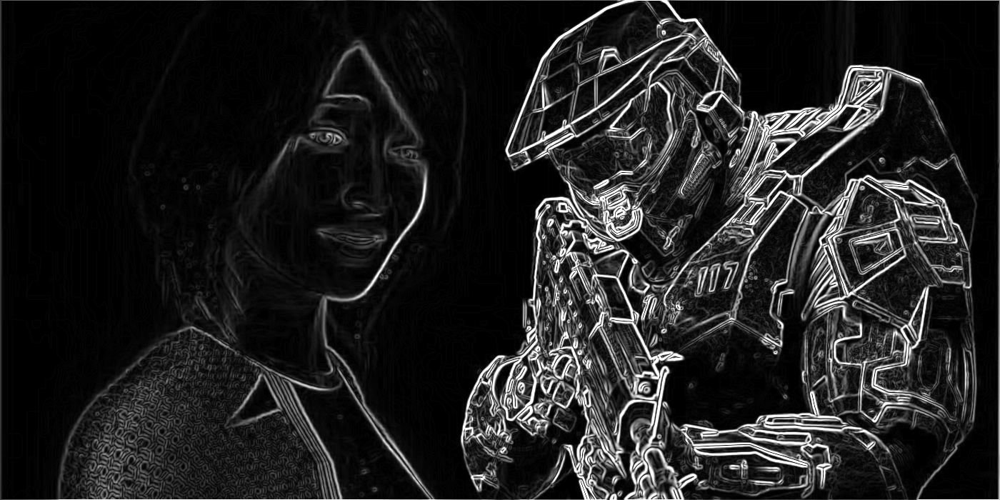

# Examples

## Example Programs

The programs under `examples/` demonstrate individual CVL operations.  
Build them with `-DBUILD_EXAMPLES=ON`.

| Executable  | Source             | What it does                    |
| ----------- | ------------------ | ------------------------------- |
| `cvl_sobel` | `examples/sobel.c` | Sobel gradient magnitudes       |
| `cvl_blur`  | `examples/blur.c`  | Mean, Gaussian, and median blur |

<!-- | `cvl_color`     | `examples/color.c`     | RGB to grayscale                                  | -->
<!-- | `cvl_threshold` | `examples/threshold.c` | Truncate, binary, to-zero, and inverse thresholds | -->
<!-- | `cvl_ccl`       | `examples/ccl.c`       | Connected component labeling                      | -->
<!-- | `cvl_resize`    | `examples/resize.c`    | Nearest and bilinear resize                       | -->
<!-- | `cvl_rotate`    | `examples/rotate.c`    | Orthogonal and arbitrary rotation                 | -->
<!-- | `cvl_cs136`     | `examples/cs136.c`     | Course checkpoints (noise, morphology, labeling)  | -->

## Usage Examples

The following examples demonstrate how CVL operations can be combined into
practical image-procesing workflows.

## Edge Detection

Edge detection identifies locations of significant intensity changes in an image.

### Sobel Operator

The Sobel operator estimates image gradients using horizontal and vertical
convolution kernels. These gradients can be combined to estimate edge magnitude
and direction.

|           Original           |                   Smoothed grayscale                   |                   Magnitudes                    |
| :--------------------------: | :----------------------------------------------------: | :---------------------------------------------: |
|  |  |  |

```c
#include <cvl/cvl.h>

int main(void) {
    // Load Input Image.
    cvl_Mat img = cvl_imread("./data/original/halo.ppm");
    cvl_Mat gray = cvl_cvt_color_new(&img, CVL_COLOR_RGB2GRAY);
    cvl_Mat blur = cvl_blur_gauss_new(&gray, 0.0, 1.0);

    // Apply Sobel Filter (for gradient magnitudes).
    cvl_Mat sobel = cvl_sobel_mag_new(&blur);

    // Save Results.
    cvl_imwrite("./data/modified/1-original.ppm", &img);
    cvl_imwrite("./data/modified/2-blur.pgm", &blur);
    cvl_imwrite("./data/modified/5-mags.pgm", &sobel);

    // Cleanup.
    cvl_mat_free(&sobel);
    cvl_mat_free(&blur);
    cvl_mat_free(&gray);
    cvl_mat_free(&img);

    return 0;
}

```

<!-- See [algorithms/sobel](algorithms/sobel) for more information on the Sobel operator. -->
